# HenrySkillz MPC Sample Mod Kit

**Nine studio effects for the Akai MPC Sample, installed from a web page in about 15 minutes.**
No coding, no terminal, no apps to install, no AI tools. Free.

Made by [Henry Skillz](https://www.henryskillz.com) in Melbourne. Built on top of [SampQOL OS](https://github.com/snarebes/SampQOL-OS) by **Snare Bes**.

### [Open the installer](https://holla-back-entertainment.github.io/henryskillz-mpc-sample-mod-kit/install/) · [How to use it](docs/USER-GUIDE.md) · [Compatibility](docs/COMPATIBILITY.md) · [Step-by-step guide](docs/INSTALL-GUIDE.md) · [Update just the effects](docs/UPDATE-EFFECTS.md) · [FAQ](docs/FAQ.md) · [Undo it](docs/RECOVERY.md)

> **Unofficial.** Not made, endorsed or supported by Akai Professional, inMusic or the SampQOL author.
> Everything runs from the SD card. Switch off and take the card out, and the MPC is stock again.

> **Tested:** the installer on a pristine official SampQOL 0.2.0 package (Chrome and Safari), including a virtual-MPC boot of the generated output. The v0.5 build passed a hardware boot test on Henry's own MPC Sample. Changes since then—including Stems onto pads, chain boxes, screen styling, the graphic mixer and effect presets—remain emulator-tested until the current [hardware checklist](docs/BOOT-TEST.md) passes. Every unit and card is different, so **back up your card first**, and [report anything odd](https://github.com/Holla-Back-Entertainment/henryskillz-mpc-sample-mod-kit/issues).

---

## What you get

For how to use every feature, button by button, see the [user guide](docs/USER-GUIDE.md).

| Effect | Category | What it does |
|---|---|---|
| **HS Saturator** | Harmonic | Saturation for drums and bass |
| **HS Channel Strip** | Harmonic | Console-style channel: filters, 4-band EQ, compressor, gate |
| **HS Bus Compressor** | Dynamics | Bus compressor with a sidechain high-pass |
| **HS Pump** | Dynamics | Stepped feedback compressor, 1:1 to 20:1, with an Opto release, attack modifier and output saturation |
| **HS Heat** | Harmonic | Eight drive circuits into a multimode filter, with dirt, a 2-band EQ, an envelope follower and an LFO |
| **HS Para EQ** | EQ / Filter | Parametric EQ with a response-curve display |
| **HS Crush** | Dynamics | Character compressor: eight curves from 1:1 to Max, an Opto mode, detector filters, two distortion modes, a British-style mode and a gain-reduction meter |
| **HS Bass Focus** | EQ / Filter | Splits at a crossover (30 to 500 Hz), makes the lows mono and sets their level. The highs pass untouched |
| **HS Tube Strip** | Harmonic | Tube channel strip: tube drive, a 6 dB/oct high-pass, an opto compressor with a gain-reduction meter and a 4-band EQ, with the EQ before or after the compressor and a side-chain EQ for de-essing |

**Where did HS Air Exciter, HS Drive Sat and the stock Bus Compressor go?** SampQOL's insert menu has 40 rows. To fit nine HS effects, the stock Bus Compressor leaves the Dynamics list (HS Bus Compressor and HS Crush cover it), and HS Air Exciter and HS Drive Sat leave the menu. All three are still installed: a project that already uses them opens with them, as before.

Plus live displays for the stock effects while you turn the knobs, a dB/Hz grid on the EQ page, and the HenrySkillz start screen (after SampQOL's own).

**SEQ page as a mixing desk.** The SEQ page (tempo, bars, Rec Quant) is redrawn as a desk panel with a VU meter and output LEDs that move with what the MPC is playing, and the **K1 BPM** label stays clear. Every stock control works as before. **B2** switches to the **METERS** page: left and right VU meters, loudness Momentary, Short-term and Integrated (EBU R128) and a peak hold. Integrated and peak restart after 2 seconds of silence. **B2** again goes back to the desk.

**De-esser.** HS Channel Strip has a **DESS** page: Freq, Thresh, Range and Mode (split, wide, or listen to hear just what it removes).

**Per-effect presets.** On Channel Strip, Drive Sat, Bus Compressor, Pump, Heat, Crush and Tube Strip, hold **B2** for half a second to open **PRESETS**. Choose one of eight slots with **K1** or **DATA**, use **SHIFT+B3** to load, and hold **B3** to save. Presets live on the SD card under `MPC-Sample/Presets`, so they are available in other projects.

**MOD and the key bus.** HS Pump and HS Crush have a **KEY** page that sends their input to bus A, B, C or D, or keys their compressor from one. Seven HS effects (Pump, Crush, Tube Strip, Heat, Channel Strip, Drive Sat, Bus Compressor) have a **MOD** page: pick a bus as the Source, a knob as the Target and a Depth, and that knob moves with the level on the bus. **MOD TIME** sets the attack and release. Off by default, so old projects sound the same.

**One Bypass.** Every HS effect uses the Bypass button above the screen. The old Bypass knobs on Drive Sat, Bus Compressor and Para EQ are gone (projects that used them still open).

**Track chains.** Rename a track **VOX**, **DRUMS** or **BASS** (or any name that starts with one, like "Vox Lead") and, if the track has no inserts yet, its chain loads: Channel Strip, Bus Compressor and Air Exciter on VOX, Saturator and Bus Compressor on DRUMS, Drive Sat and Para EQ on BASS. One UNDO takes back the rename and the chain together. To save your own, dial in a track's inserts and rename it with a **#** on the end, like **KEYS#**: the chain is saved to `MPC-Sample/Chains/KEYS.xfx` on the card, the track is named KEYS again, and any track you name KEYS gets it. A short box on the screen says what happened: **Chain loaded**, **Chain saved**, or why not (the track already has effects, no effects to save).

**Key and BPM in the browser.** Preview a sample and its row shows the key and the tempo the preview plays at, like **C# MIN 75 BPM**. WAV and MP3.

**Stems (optional).** Tick **Add Stems** on the installer and the MPC can split a sample into Vocals, Drums, Bass and Other by itself, no computer. In the browser, preview a WAV or MP3, hold **SHIFT** and hold **B1** for 1.5 seconds. On the Sample screen, hold **SHIFT** and hold **B3** for 1.5 seconds to split the selected pad's sample. Tick the stems you want, choose **Separate** (one file each) or **Sum** (one mixed file), then **Go**. A pad split also loads the stems onto the next empty pads of that pad's bank, on the same track, and the box says where ("On pads A02-A05"). If the bank is full, the files stay in `MPC-Sample/Samples/Stems` and the box says so. Each stem on a pad is one UNDO. A split takes about as long as the sample plays; nothing above 11 kHz comes through. It adds a 92 MB download and uses the Spleeter model by Deezer (MIT).

**SampQOL screens in HS colours.** SampQOL's own list screens (the insert pages, the effect list) get a red bar along the top, a cyan edge on the selected row and a dark blue palette, to match the rest of the kit.

**Graphic mixer.** **PAD FX** then **B2** shows SampQOL's Ch. Mixer, and **B2** again the Pad Mixer, as a console: eight strips per page with pan, mute and solo, a fader, a stereo meter with peak hold and the output. The selected strip has a cyan frame, yellow while you edit it.

**Page label.** On HS effects with more than one page, the box over the middle screen button shows **PAGE 2/3**: press it for the next page, **SHIFT** + it to go back.

| SEQ desk page | METERS page (B2) | Page label |
|---|---|---|
| 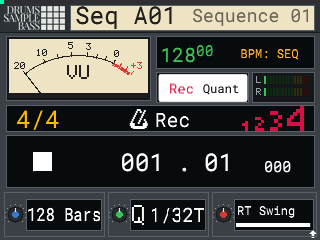 | 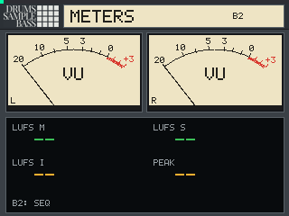 | 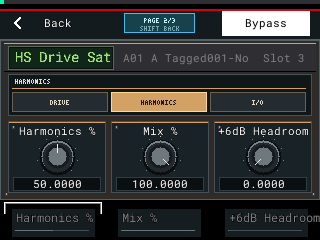 |

| Chain loaded | Stems chooser | Stems on pads |
|---|---|---|
| 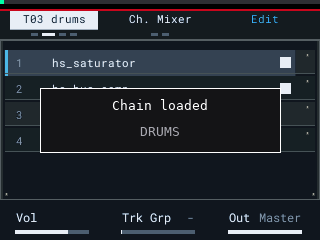 | 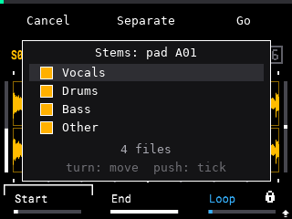 | 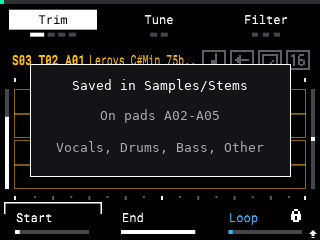 |

| SampQOL screen styling | Graphic mixer | Key and BPM tag |
|---|---|---|
| 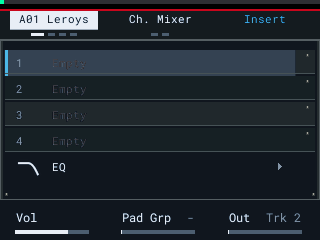 | 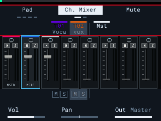 | 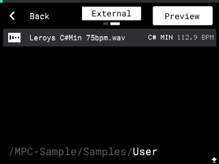 |

| Preset slots | Channel Strip de-esser |
|---|---|
| 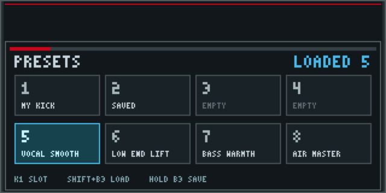 | 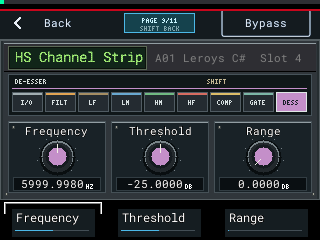 |

These are real 320×240 captures from the MPC Sample emulator running the public installer output:

| HS Saturator |
|---|
| 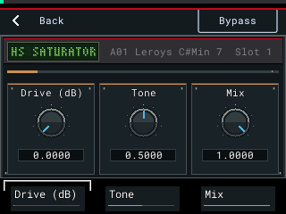 |

| HS Channel Strip | HS Para EQ | HS Bus Compressor |
|---|---|---|
|  |  |  |

| HS Pump | HS Heat | HS Heat, filter page |
|---|---|---|
|  |  |  |

| HS Crush | HS Bass Focus | HS Tube Strip |
|---|---|---|
|  |  |  |

The HS Pump, HS Heat, HS Crush, HS Bass Focus, HS Tube Strip, presets and de-esser panels above are rendered from the same panel drawing code in `src/fx/`, not captured from the emulator yet. All other pictures in this section are emulator captures.

## What you need

- An **Akai MPC Sample** on firmware **1.3.0** (1.3.0.12)
- An **exFAT SD card**
- A **Mac or Windows** computer with a web browser
- **SampQOL OS 0.2.0**, downloaded free from [Snare Bes's official page](https://github.com/snarebes/SampQOL-OS/releases)

**Not on SampQOL?** HS Tools runs on stock firmware 1.3.0: on-device stems, browser key and BPM tags, and the SEQ desk with LUFS meters. Download `henryskillz-mpc-sample-hs-tools.zip` from the [latest release](https://github.com/Holla-Back-Entertainment/henryskillz-mpc-sample-mod-kit/releases/latest), copy its `autorun` folder to an exFAT SD card and power on. The effects and track chains need SampQOL.

## Install in 5 steps

1. **Back up** everything on your SD card to your computer.
2. **Download** `SampQOL-OS-v0.2.0.zip` from the [official SampQOL page](https://github.com/snarebes/SampQOL-OS/releases).
3. **Open** the [installer](https://holla-back-entertainment.github.io/henryskillz-mpc-sample-mod-kit/install/) and drop the zip on it. Click **Download autorun-hs.zip**.
4. **Unzip** it and copy the `autorun` folder to the top level of your SD card.
5. **Eject** the card, put it in the MPC, switch on and press **B1** to start.

The HS effects are in the insert effects list.

**Already installed and want the new effects?** You don't need to reinstall: [update just the effects](docs/UPDATE-EFFECTS.md). **New to this? Follow the [step-by-step guide](docs/INSTALL-GUIDE.md).** It covers formatting, Mac and Windows, and what to do if anything looks wrong.

The installer runs entirely in your browser. Your files are never uploaded.
Prefer offline? Download `henryskillz-mpc-sample-installer.html` from [Releases](https://github.com/Holla-Back-Entertainment/henryskillz-mpc-sample-mod-kit/releases/latest) and double-click it.

## Undo it

Switch off and take the SD card out. That's it. More options in [RECOVERY.md](docs/RECOVERY.md).

## Help

- **[FAQ](docs/FAQ.md)**: errors, versions, warranty, "it booted stock".
- **[Troubleshooting](docs/TROUBLESHOOTING.md)**: what to check when something does not work.
- **[Report a problem](https://github.com/Holla-Back-Entertainment/henryskillz-mpc-sample-mod-kit/issues)**: include your firmware version, what you did and what you saw.
- Questions about the **HS effects or this installer go here**, not to the SampQOL author or Akai.

## About SampQOL OS, and why you download it yourself

SampQOL OS is **Snare Bes's** work and the foundation this kit runs on. His license says SampQOL is only shared from his official download, never re-uploaded, and never presented as someone else's work.
So this kit:
- **never contains SampQOL**: you get it from him, so you always have his genuine, current release;
- changes **your own copy**, on **your own computer**, which his license allows for personal use;
- keeps **his license, his name and his start screen** in your copy;
- contains only HenrySkillz's own code (the effects, displays, installer and splash).

If you like SampQOL, star [his repository](https://github.com/snarebes/SampQOL-OS) and read his manual. It does far more than this kit.
If the SampQOL author ever asks for anything here to change or come down, it will.

## Build your own

Want to write your own add-ons or your own MPC Sample OS? **[BUILD-YOUR-OWN.md](docs/BUILD-YOUR-OWN.md)** explains how it works, how to make your own start screen, and Snare Bes's rules in plain English.
Technical details: [HOW-IT-WORKS.md](docs/HOW-IT-WORKS.md).

There's also a **starter card** on the [Releases](https://github.com/Holla-Back-Entertainment/henryskillz-mpc-sample-mod-kit/releases/latest) page: the smallest possible mod. It shows the HenrySkillz screen, then starts the normal MPC.
**It has no effects.** It's a boot test and a template for building your own.

## Henry Skillz

DJ, producer and creative from Melbourne. Ableton Live and an Akai MPC.

- Web: [henryskillz.com](https://www.henryskillz.com)
- Instagram: [@henryskillz](https://www.instagram.com/henryskillz/)
- YouTube: [@henryskillz](https://www.youtube.com/@henryskillz)
- TikTok: [@henryskillzau](https://www.tiktok.com/@henryskillzau)
- Spotify: [Henry Skillz](https://open.spotify.com/artist/1zC2DSxilYhhqyojCBerYl)
- Mixcloud: [DJ sets](https://www.mixcloud.com/incredibleskillz/)
- Email: [henryskillz@spacely.clothing](mailto:henryskillz@spacely.clothing)

**Digging for samples?** [Crate Source](https://crate-source.app) is Henry's crate-digging app: find a record, chop it, load it onto your MPC.

## Support the work

This kit is free and always will be. If it helped you, support it by shopping **[Spacely](https://www.spacely.clothing)**
([Instagram](https://www.instagram.com/spacelyclothing/) · [TikTok](https://www.tiktok.com/@spacely.co)), or follow along on the links above.
Support is optional and unlocks nothing.

## Credits and license

- **[SampQOL OS](https://github.com/snarebes/SampQOL-OS)** by Snare Bes: the mod this kit is built on. Not included; get it from him.
- **[mpc-sample-root-ssh](https://github.com/orrpunk-art/mpc-sample-root-ssh)** by orrpunk-art: published how the MPC Sample's `autorun.check` is made.
- The MPC-Forums community, for the shared findings.

Full notices: [THIRD_PARTY_NOTICES.md](THIRD_PARTY_NOTICES.md). HenrySkillz code is under the [MIT License](LICENSE). SampQOL OS has its own license and is not part of this repository.

Akai Professional, MPC and MPC Sample are trademarks of inMusic Brands, Inc. This project is not affiliated with them.
