# HenrySkillz MPC Sample Mod Kit

**Nine studio effects for the Akai MPC Sample, installed from a web page in about 15 minutes.**
No coding, no terminal, no apps to install, no AI tools. Free.

Made by [Henry Skillz](https://www.henryskillz.com) in Melbourne. Built on top of [SampQOL OS](https://github.com/snarebes/SampQOL-OS) by **Snare Bes**.

### [Open the installer](https://hmukhwana.github.io/henryskillz-mpc-sample-mod-kit/install/) · [Step-by-step guide](docs/INSTALL-GUIDE.md) · [Update just the effects](docs/UPDATE-EFFECTS.md) · [FAQ](docs/FAQ.md) · [Undo it](docs/RECOVERY.md)

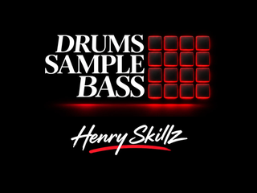

> **Unofficial.** Not made, endorsed or supported by Akai Professional, inMusic or the SampQOL author.
> Everything runs from the SD card. Switch off and take the card out, and the MPC is stock again.

> **Tested:** the installer on the official SampQOL 0.2.0 download (Chrome and Safari), and this exact build booted end to end in an MPC Sample emulator.
> The HS effects have run on Henry's own MPC Sample. **HS Crush, HS Bass Focus and HS Tube Strip are new:** they pass the emulator boot test but have not been boot-tested on hardware yet. Every unit and card is different, so **back up your card first**, and [report anything odd](https://github.com/hmukhwana/henryskillz-mpc-sample-mod-kit/issues).

---

## What you get

| Effect | Category | What it does |
|---|---|---|
| **HS Saturator** | Harmonic | Saturation for drums and bass |
| **HS Channel Strip** | Harmonic | Console-style channel: filters, 4-band EQ, compressor, gate |
| **HS Bus Compressor** | Dynamics | Bus compressor with a sidechain high-pass |
| **HS Pump** | Dynamics | Stepped feedback compressor, 1:1 to 20:1, with an Opto release, attack modifier and output saturation |
| **HS Heat** | Harmonic | Eight drive circuits into a multimode filter, with dirt, a 2-band EQ, an envelope follower and an LFO |
| **HS Para EQ** | EQ / Filter | Parametric EQ with a response-curve display |
| **HS Crush** | Dynamics | Character compressor: eight curves from 1:1 to Max, an Opto mode, detector filters, two distortion modes, a British-style mode and a gain-reduction meter |
| **HS Bass Focus** | EQ / Filter | Splits at a crossover (30 to 500 Hz), makes the lows mono and sets their level. The highs pass untouched |
| **HS Tube Strip** | Harmonic | Tube channel strip: tube drive, a 6 dB/oct high-pass, an opto compressor with a gain-reduction meter and a 4-band EQ, with the EQ before or after the compressor and a side-chain EQ for de-essing |

**Where did HS Air Exciter, HS Drive Sat and the stock Bus Compressor go?** SampQOL's insert menu has 40 rows. To fit nine HS effects, the stock Bus Compressor leaves the Dynamics list (HS Bus Compressor and HS Crush cover it), and HS Air Exciter and HS Drive Sat leave the menu. All three are still installed: a project that already uses them opens with them, as before.

Plus live displays for the stock effects while you turn the knobs, a dB/Hz grid on the EQ page, a desk-style SEQ page with an unobstructed **K1 BPM** label and B2-toggleable stereo meters, and the HenrySkillz start screen (after SampQOL's own).

These are real 320×240 captures from the MPC Sample emulator running the public installer output:

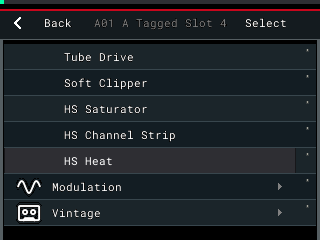

| HS Channel Strip | HS Para EQ | HS Bus Compressor |
|---|---|---|
| 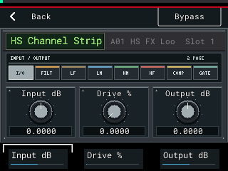 | 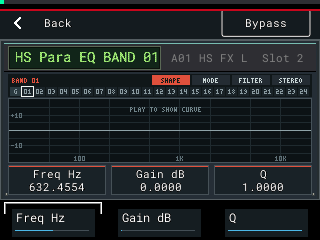 | 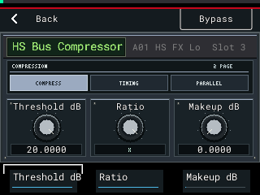 |

| HS Pump | HS Heat | HS Heat, filter page |
|---|---|---|
| 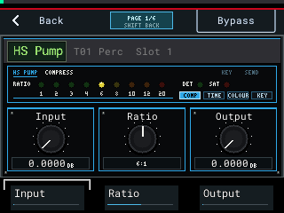 | 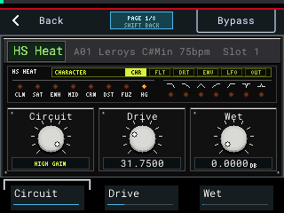 | 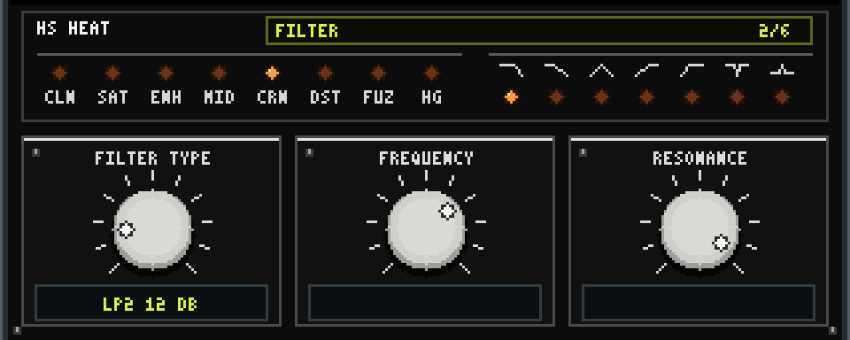 |

| HS Crush | HS Bass Focus | HS Tube Strip |
|---|---|---|
| 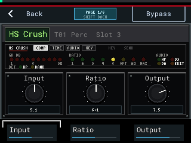 | 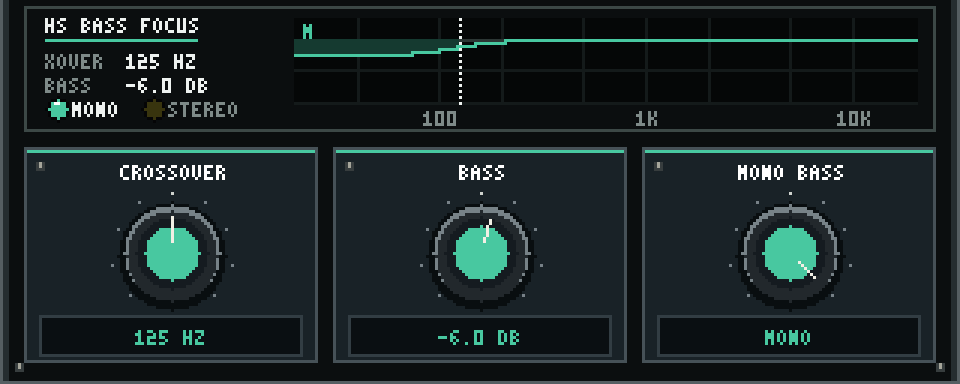 | 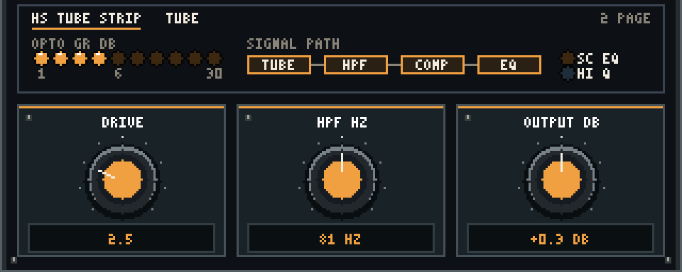 |

The HS Pump, HS Heat, HS Crush, HS Bass Focus and HS Tube Strip panels above are rendered at 3× from the panel drawing code in `src/fx/` (`panel-render.c` for the last three), not captured from the emulator yet.

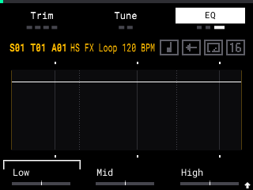

## What you need

- An **Akai MPC Sample** on firmware **1.3.0** (1.3.0.12)
- An **exFAT SD card**
- A **Mac or Windows** computer with a web browser
- **SampQOL OS 0.2.0**, downloaded free from [Snare Bes's official page](https://github.com/snarebes/SampQOL-OS/releases)

## Install in 5 steps

1. **Back up** everything on your SD card to your computer.
2. **Download** `SampQOL-OS-v0.2.0.zip` from the [official SampQOL page](https://github.com/snarebes/SampQOL-OS/releases).
3. **Open** the [installer](https://hmukhwana.github.io/henryskillz-mpc-sample-mod-kit/install/) and drop the zip on it. Click **Download autorun-hs.zip**.
4. **Unzip** it and copy the `autorun` folder to the top level of your SD card.
5. **Eject** the card, put it in the MPC, switch on and press **B1** to start.

The HS effects are in the insert effects list.

**Already installed and want the new effects?** You don't need to reinstall: [update just the effects](docs/UPDATE-EFFECTS.md). **New to this? Follow the [step-by-step guide](docs/INSTALL-GUIDE.md).** It covers formatting, Mac and Windows, and what to do if anything looks wrong.

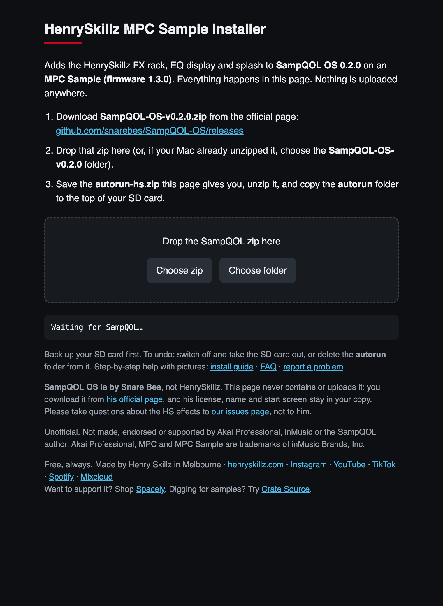

The installer runs entirely in your browser. Your files are never uploaded.
Prefer offline? Download `henryskillz-mpc-sample-installer.html` from [Releases](https://github.com/hmukhwana/henryskillz-mpc-sample-mod-kit/releases/latest) and double-click it.

## Undo it

Switch off and take the SD card out. That's it. More options in [RECOVERY.md](docs/RECOVERY.md).

## Help

- **[FAQ](docs/FAQ.md)**: errors, versions, warranty, "it booted stock".
- **[Report a problem](https://github.com/hmukhwana/henryskillz-mpc-sample-mod-kit/issues)**: include your firmware version, what you did and what you saw.
- Questions about the **HS effects or this installer go here**, not to the SampQOL author or Akai.

## About SampQOL OS, and why you download it yourself

SampQOL OS is **Snare Bes's** work and the foundation this kit runs on. His license says SampQOL is only shared from his official download, never re-uploaded, and never presented as someone else's work.
So this kit:
- **never contains SampQOL**: you get it from him, so you always have his genuine, current release;
- changes **your own copy**, on **your own computer**, which his license allows for personal use;
- keeps **his license, his name and his start screen** in your copy;
- contains only HenrySkillz's own code (the effects, displays, installer and splash).

If you like SampQOL, star [his repository](https://github.com/snarebes/SampQOL-OS) and read his manual. It does far more than this kit.
If the SampQOL author ever asks for anything here to change or come down, it will.

## Build your own

Want to write your own add-ons or your own MPC Sample OS? **[BUILD-YOUR-OWN.md](docs/BUILD-YOUR-OWN.md)** explains how it works, how to make your own start screen, and Snare Bes's rules in plain English.
Technical details: [HOW-IT-WORKS.md](docs/HOW-IT-WORKS.md).

There's also a **starter card** on the [Releases](https://github.com/hmukhwana/henryskillz-mpc-sample-mod-kit/releases/latest) page: the smallest possible mod. It shows the HenrySkillz screen, then starts the normal MPC.
**It has no effects.** It's a boot test and a template for building your own.

## Henry Skillz

DJ, producer and creative from Melbourne. Ableton Live and an Akai MPC.

- Web: [henryskillz.com](https://www.henryskillz.com)
- Instagram: [@henryskillz](https://www.instagram.com/henryskillz/)
- YouTube: [@henryskillz](https://www.youtube.com/@henryskillz)
- TikTok: [@henryskillzau](https://www.tiktok.com/@henryskillzau)
- Spotify: [Henry Skillz](https://open.spotify.com/artist/1zC2DSxilYhhqyojCBerYl)
- Mixcloud: [DJ sets](https://www.mixcloud.com/incredibleskillz/)
- Email: [henryskillz@spacely.clothing](mailto:henryskillz@spacely.clothing)

**Digging for samples?** [Crate Source](https://crate-source.app) is Henry's crate-digging app: find a record, chop it, load it onto your MPC.

## Support the work

This kit is free and always will be. If it helped you, support it by shopping **[Spacely](https://www.spacely.clothing)**
([Instagram](https://www.instagram.com/spacelyclothing/) · [TikTok](https://www.tiktok.com/@spacely.co)), or follow along on the links above.
Support is optional and unlocks nothing.

## Credits and license

- **[SampQOL OS](https://github.com/snarebes/SampQOL-OS)** by Snare Bes: the mod this kit is built on. Not included; get it from him.
- **[mpc-sample-root-ssh](https://github.com/orrpunk-art/mpc-sample-root-ssh)** by orrpunk-art: published how the MPC Sample's `autorun.check` is made.
- The MPC-Forums community, for the shared findings.

Full notices: [THIRD_PARTY_NOTICES.md](THIRD_PARTY_NOTICES.md). HenrySkillz code is under the [MIT License](LICENSE). SampQOL OS has its own license and is not part of this repository.

Akai Professional, MPC and MPC Sample are trademarks of inMusic Brands, Inc. This project is not affiliated with them.
