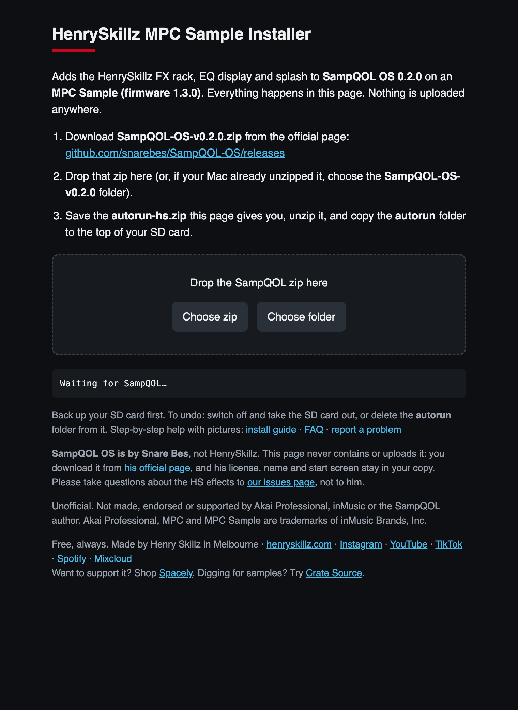

# Install guide, step by step

This guide assumes you have never modded anything. Follow it in order and don't skip the backup.
It takes about 15 minutes.

**You need:**
- An Akai **MPC Sample** on firmware **1.3.0** (1.3.0.12)
- An **SD card** (any size; 8 GB or more is plenty)
- A Mac or Windows computer with an SD card slot or reader
- A web browser (Safari, Chrome, Edge or Firefox)

**You don't need:** coding, a terminal, Python, AI tools, a GitHub account or any app to install.

---

## Step 1. Check your MPC's firmware

This kit, and SampQOL itself, only run on firmware **1.3.0** (1.3.0.12). Not sure which version you have? Install 1.3.0 with Akai's official MPC Sample updater, and you're sure.

- **1.3.0 / 1.3.0.12:** carry on.
- **Anything else:** update with Akai's official updater first. If you skip this, nothing breaks: the MPC ignores the card and starts as normal.

## Step 2. Back up your SD card

1. Put the SD card in your computer.
2. Make a folder on your computer called `MPC card backup` with today's date.
3. Copy **everything** on the SD card into that folder.

Your projects and samples are now safe whatever happens.
SampQOL's own manual warns that a failed project load can delete samples, so keep making backups.

## Step 3. Make sure the card is exFAT

The MPC reads **exFAT** cards. Most cards already are. To check:

- **Mac:** select the card in Finder, press **Cmd + I**. Look at *Format*.
- **Windows:** in File Explorer, right-click the card > **Properties**. Look at *File system*.

If it isn't exFAT, format it. **Formatting erases the card, so do Step 2 first.**

- **Mac:** open **Disk Utility**, select the card, click **Erase**, set Format to **ExFAT**, click Erase.
- **Windows:** right-click the card > **Format**, set File system to **exFAT**, click Start.

Then copy your backup back onto the card.

## Step 4. Download SampQOL 0.2.0 (from its author)

1. Go to the [official SampQOL OS releases page](https://github.com/snarebes/SampQOL-OS/releases).
2. Find **v0.2.0** and, under *Assets*, click **`SampQOL-OS-v0.2.0.zip`**.

Get it only from that page. It's the author's official download, and the installer checks it's the exact file.

> **Safari on a Mac** may unzip it for you and leave a folder called `SampQOL-OS-v0.2.0` in Downloads. That's fine: use the folder in Step 6.

## Step 5. Open the installer

**Easiest:** open the [online installer](https://hmukhwana.github.io/henryskillz-mpc-sample-mod-kit/install/) in your browser.

**Or offline:** download `henryskillz-mpc-sample-installer.html` from [Releases](https://github.com/hmukhwana/henryskillz-mpc-sample-mod-kit/releases/latest) and double-click it.

Both versions work the same way. Everything happens inside your browser: your files are never uploaded.



## Step 6. Give it SampQOL

Either:
- **Drag `SampQOL-OS-v0.2.0.zip`** onto the dashed box, or
- click **Choose zip** and pick it, or
- if your Mac unzipped it, click **Choose folder** and pick the `SampQOL-OS-v0.2.0` folder. Your browser may ask you to confirm uploading the folder. Nothing actually leaves your computer; that's just the browser's standard wording.

After a second or two you should see:

> SampQOL 0.2.0 checked. Add-ons installed, autorun signed.

and a **Download autorun-hs.zip** link. Click it.

**If you see a red message,** it tells you what's wrong. The common one is *"This is not SampQOL 0.2.0"*: download the zip again from the official page (Step 4).

## Step 7. Unzip it

- **Mac:** double-click `autorun-hs.zip` in Downloads. You get a folder called `autorun`.
- **Windows:** right-click `autorun-hs.zip` > **Extract All** > Extract. Open the result: inside is a folder called `autorun`.

## Step 8. Copy it to the SD card

1. Open the SD card on your computer.
2. If there's already a folder called `autorun` on it, rename that to `autorun-old`.
3. Drag the new **`autorun`** folder onto the **top level** of the card, not inside another folder.

The card should look like this:

```text
SD card
├── autorun                 <- the new folder
│   ├── autorun.check
│   ├── autorun.json
│   ├── autorun.sh
│   ├── hs                  <- the HenrySkillz add-ons
│   ├── LICENSE.txt         <- SampQOL's license (keep it)
│   ├── mpcqol.so
│   ├── qol-run.sh
│   └── ... other SampQOL files
└── your projects and samples
```

Don't open or edit any file inside `autorun`. Changing even one character makes the MPC skip the whole folder.

## Step 9. Eject safely

- **Mac:** click the eject arrow next to the card in Finder.
- **Windows:** right-click the card > **Eject**.

Wait until it says it's safe, then take the card out.

## Step 10. Boot the MPC

1. With the MPC switched off, put the SD card in.
2. Switch it on.
3. When it asks **Start SampQOL OS?**, press **B1** (Start).
4. You'll see SampQOL's start screen, then the HenrySkillz screen, then the MPC.


## Step 11. Find the effects

Wherever you choose an insert effect (for example a pad's insert slots in the **Mixer**), the HenrySkillz effects are in the list. Their names start with **HS**:

- **Harmonic:** HS Saturator, HS Air Exciter, HS Channel Strip, HS Drive Sat
- **Dynamics:** HS Bus Compressor
- **EQ / Filter:** HS Para EQ

Done. Make something.

---

## Undo it

Switch off and take the SD card out. That's it: without the card, the MPC is stock.
More options: [RECOVERY.md](RECOVERY.md). Something not right: [FAQ.md](FAQ.md).
