# How to use the HenrySkillz Mod Kit

This guide shows how to use everything the kit adds to your MPC Sample, one button at a time.
It assumes the kit is already installed. If it isn't, start with the [step-by-step install guide](INSTALL-GUIDE.md).

You don't need to know anything about modding. If you can load a sample and play a pad, you can use all of this.

## Contents

- [The buttons this guide talks about](#the-buttons-this-guide-talks-about)
- [Open an HS effect](#open-an-hs-effect)
- [Move between pages](#move-between-pages)
- [Save and load effect presets](#save-and-load-effect-presets)
- [One Bypass](#one-bypass)
- [HS Saturator](#hs-saturator)
- [HS Channel Strip (with the DESS de-esser)](#hs-channel-strip)
- [HS Bus Compressor](#hs-bus-compressor)
- [HS Pump](#hs-pump)
- [HS Heat](#hs-heat)
- [HS Para EQ](#hs-para-eq)
- [HS Crush](#hs-crush)
- [HS Bass Focus](#hs-bass-focus)
- [HS Tube Strip](#hs-tube-strip)
- [HS Air Exciter and HS Drive Sat](#hs-air-exciter-and-hs-drive-sat)
- [MOD and the key bus](#mod-and-the-key-bus)
- [Track chains](#track-chains)
- [Key and BPM in the browser](#key-and-bpm-in-the-browser)
- [SEQ desk and the METERS page](#seq-desk-and-the-meters-page)
- [Stems](#stems)
- [SampQOL screens in HS colours](#sampqol-screens-in-hs-colours)
- [Graphic mixer](#graphic-mixer)
- [Project snapshots](#project-snapshots)

---

## The buttons this guide talks about

- **B1**, **B2**, **B3**: the three buttons above the screen, left to right. The screen shows what each one does right now.
- **K1**, **K2**, **K3**: the three knobs below the screen, left to right.
- **DATA**: the big wheel. You can turn it and push it.
- **SHIFT**, **PAD FX**, **SEQ**, **UNDO** and the rest: named as printed on the MPC.
- **UNDO** is **SHIFT** + **MINUS (-)**.

Every HS effect has three knobs on each page. **K1**, **K2** and **K3** turn them, from left to right.

---

## Open an HS effect

1. Press **PAD FX**.
2. Press **B1** to step through the insert pages: Pad, Track, Submix and Master.
3. Turn **DATA** to pick an insert slot.
4. On an **empty slot**, push **DATA**. The effect list opens.
5. Pick a category, then the effect. The HS effects sit in these categories:

| Category | HS effects |
|---|---|
| Harmonic | HS Saturator, HS Channel Strip, HS Heat, HS Tube Strip |
| Dynamics | HS Bus Compressor, HS Pump, HS Crush |
| EQ / Filter | HS Para EQ, HS Bass Focus |

6. On a slot that **already has an effect**, press **B3** (Edit) to open it.

To go back, press **B1** (Back) or **PAD FX**.

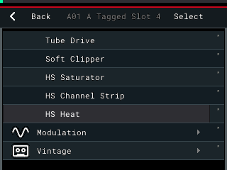

A new HS effect always opens on its first page. If you leave an effect and open the same one again, it comes back on the page you left it on.

If it doesn't work: check you are on the right insert page (Pad, Track, Submix or Master) and that the HS rows are in the list. If no HS rows show at all, see the [FAQ](FAQ.md).

---

## Move between pages

Most HS effects have more than three controls, so they are split into pages.

- Press **B2** for the next page. The box over **B2** shows where you are, like **PAGE 2/3**.
- Press **SHIFT** + **B2** to go back a page.
- The row of tabs across the top of the effect lights the page you are on.
- After the last page, **B2** goes round to the first page again.

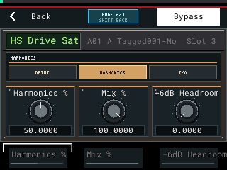

On HS Channel Strip, the COMP, GATE and DESS pages have a second row of controls, and **SHIFT** shows next to the page name. Hold **SHIFT** and turn **K1**, **K2** or **K3** to reach the second row. The guide lists these as "SHIFT + K1" and so on.

If it doesn't work: make sure the effect page itself is open (you pressed **B3** Edit). **B2** only pages HS effects that have more than one page.

---

## Save and load effect presets

Channel Strip, Drive Sat, Bus Compressor, Pump, Heat, Crush and Tube Strip each have eight preset slots. They store the complete effect, including its MOD and key-bus controls, on the SD card. Saturator, Para EQ and Bass Focus do not have this preset page.

1. Open the effect, then hold **B2** for half a second. A quick B2 press still changes page.
2. Turn **K1** or **DATA** to choose slot 1 to 8.
3. Hold **B3** for about one second to save the current controls. A quick B3 press does not overwrite anything.
4. Hold **SHIFT** and press **B3** to load the selected slot.
5. Tap or hold **B2** to leave PRESETS and return to the page you came from.

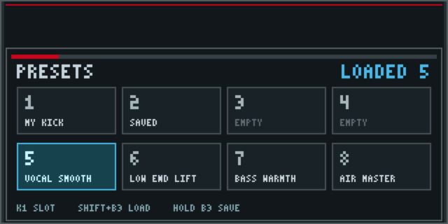

Slots are shared between projects and stay under `MPC-Sample/Presets` on the card. **EMPTY** means that slot has not been saved for this effect. A saved slot says **SAVED**; preset files can optionally put a short name in parentheses on their first line.

If it doesn't work: make sure the effect editor itself is open and hold B2, rather than tapping it. Loading an empty slot only reports that it is empty; it does not change the effect.

---

## One Bypass

Every HS effect uses the **Bypass** button above the screen: **B3**, labelled **Bypass** on the effect page. Press it to switch the effect off and on, the same as any stock effect.

HS effects have no Bypass knob. HS Drive Sat, HS Bus Compressor and HS Para EQ used to have one. Projects that used it still open, but that old knob now does nothing.

If it doesn't work: you need to be on the effect's own page, where **B3** reads **Bypass**.

---

## HS Saturator

**Category:** Harmonic. **Pages:** one.

Soft saturation for drums and bass. It adds harmonics, then filters them, so you can choose how bright the added grit is.

| Knob | Control | Range | What it does |
|---|---|---|---|
| K1 | Drive | 0 to 24 dB | How hard the signal hits the saturator. At 0 dB the effect does nothing. |
| K2 | Tone | 0 to 1 | How bright the added harmonics are. Low is dark, high is bright. |
| K3 | Mix | 0 to 1 | How much of the saturation is added. 1 is all of it. |

**Starting points**
- **Drum bus:** Drive 6 to 9 dB, Tone 0.5, Mix 1.
- **Bass:** Drive 4 to 6 dB, Tone 0.3, Mix 0.6. A darker tone keeps the low end round.

**Bypass:** **B3**.

If it doesn't work: Drive starts at 0 dB, which makes no audible change by design. Turn **K1** up.

---

## HS Channel Strip

**Category:** Harmonic. **Pages:** eleven. **I/O**, **FILT**, **LF**, **LM**, **HM**, **HF**, **COMP**, **GATE**, **DESS**, then **MOD** and **MOD TIME**.

A console-style channel. The signal goes: input and drive, filters, EQ, compressor and gate, de-esser, output. One switch puts the EQ after the compressor instead.

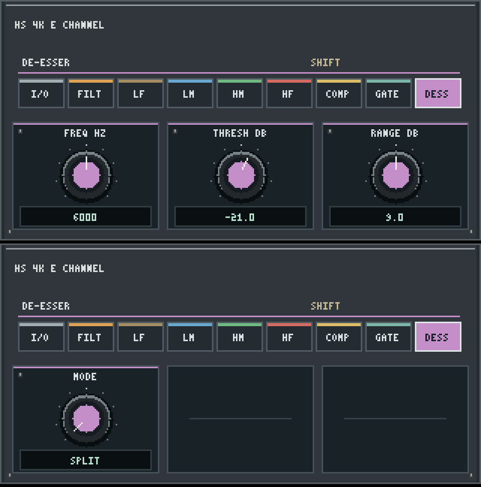

**I/O**
| Knob | Control | Range | What it does |
|---|---|---|---|
| K1 | Input | -18 to +18 dB | Level into the strip. |
| K2 | Drive | 0 to 100 % | Adds console-style drive. |
| K3 | Output | -18 to +18 dB | Level out of the strip. |

**FILT** (filters)
| Knob | Control | Range | What it does |
|---|---|---|---|
| K1 | High-Pass | 20 to 350 Hz | Cuts lows. At 20 Hz it is off. |
| K2 | Low-Pass | 3,000 to 16,000 Hz | Cuts highs. At 16,000 Hz it is off. |
| K3 | EQ First | off / on | On: the EQ comes before the compressor and gate. Off: after them. |

**LF** (low band)
| Knob | Control | Range | What it does |
|---|---|---|---|
| K1 | Gain | -18 to +18 dB | Boost or cut. |
| K2 | Frequency | 30 to 450 Hz | Where the band works. |
| K3 | Bell | off / on | Off is a shelf. On is a bell. |

**LM** (low mid)
| Knob | Control | Range | What it does |
|---|---|---|---|
| K1 | Gain | -18 to +18 dB | Boost or cut. |
| K2 | Frequency | 200 to 2,500 Hz | Where the band works. |
| K3 | Q | 0.5 to 4 | Width. Higher is narrower. |

**HM** (high mid)
| Knob | Control | Range | What it does |
|---|---|---|---|
| K1 | Gain | -18 to +18 dB | Boost or cut. |
| K2 | Frequency | 600 to 7,000 Hz | Where the band works. |
| K3 | Q | 0.5 to 4 | Width. Higher is narrower. |

**HF** (high band)
| Knob | Control | Range | What it does |
|---|---|---|---|
| K1 | Gain | -18 to +18 dB | Boost or cut. |
| K2 | Frequency | 1,500 to 16,000 Hz | Where the band works. |
| K3 | Bell | off / on | Off is a shelf. On is a bell. |

**COMP** (compressor, has a SHIFT row)
| Knob | Control | Range | What it does |
|---|---|---|---|
| K1 | Threshold | -20 to +10 | Lower means more compression. |
| K2 | Ratio | 1:1 to 20:1 | At 1:1 the compressor is off. |
| K3 | Make-Up | 0 to 18 dB | Adds level back after compression. |
| SHIFT + K1 | Fast Attack | off / on | On grabs peaks faster. |
| SHIFT + K2 | Release | 100 to 4,000 ms | How fast it lets go. |
| SHIFT + K3 | Hard Knee | off / on | On makes the compression start more suddenly. |

**GATE** (gate and expander, has a SHIFT row)
| Knob | Control | Range | What it does |
|---|---|---|---|
| K1 | Threshold | -30 to +10 | Sound below this gets turned down. |
| K2 | Range | 0 to 40 dB | How far it turns down. At 0 the gate is off. |
| K3 | Release | 100 to 4,000 ms | How fast it closes. |
| SHIFT + K1 | Fast Attack | off / on | On opens faster. |
| SHIFT + K2 | Expand | off / on | On: a gentler expander instead of a gate. |

**DESS** (de-esser, has a SHIFT row)
| Knob | Control | Range | What it does |
|---|---|---|---|
| K1 | Frequency | 3,000 to 12,000 Hz | Where it listens for "s" sounds. |
| K2 | Threshold | -50 to 0 dB | Lower means it reacts more often. |
| K3 | Range | 0 to 18 dB | The most it turns down. At 0 the de-esser is off. |
| SHIFT + K1 | Mode | SPLIT / WIDE / LISTEN | SPLIT turns down only the highs above Frequency. WIDE turns down the whole signal. LISTEN plays only the band it listens to, so you can find the "s". |

**MOD** and **MOD TIME**: see [MOD and the key bus](#mod-and-the-key-bus).

**Starting points**
- **Vocal:** FILT High-Pass 80 to 100 Hz. HM Gain +2 dB at about 3,000 Hz. COMP Ratio 3:1 to 4:1, Threshold down until the loud words are held, Make-Up 3 dB. DESS Frequency 6,000 to 7,000 Hz, Range 6 dB, Mode SPLIT, then lower Threshold until the "s" sounds soften.
- **Drum loop:** LF Gain +3 dB at 60 to 80 Hz, HF Gain +2 dB at 10,000 Hz. GATE Range 10 to 20 dB to tighten the tails.

**Bypass:** **B3**.

If it doesn't work: most sections start switched off. The compressor needs a Ratio above 1:1, the gate needs Range above 0, and the de-esser needs Range above 0. If you hear only hiss-like highs, DESS Mode is on LISTEN.

---

## HS Bus Compressor

**Category:** Dynamics. **Pages:** five. **COMPRESS**, **TIMING**, **PARALLEL**, then **MOD** and **MOD TIME**.

A bus compressor for gluing drums or a whole beat together, with a sidechain high-pass so the kick doesn't pump everything.

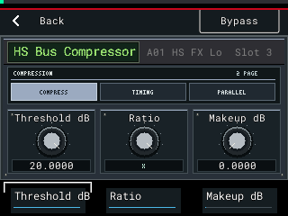

**COMPRESS**
| Knob | Control | Range | What it does |
|---|---|---|---|
| K1 | Threshold | -20 to +20 dB | Lower means more compression. |
| K2 | Ratio | 1.5:1, 2:1, 3:1, 4:1, 10:1, 20:1, X | How hard it compresses. |
| K3 | Make-Up | -5 to +15 dB | Level after compression. |

**TIMING**
| Knob | Control | Range | What it does |
|---|---|---|---|
| K1 | Attack | 0.1, 0.3, 1, 3, 10, 20, 30 ms | Slower attack lets more punch through. |
| K2 | Release | 0.1, 0.3, 0.4, 0.6, 0.8, 1.2 s, AUTO | AUTO follows the music. |
| K3 | Sidechain HP | OFF, 20 to 185 Hz | Stops the lows from driving the compressor. |

**PARALLEL**
| Knob | Control | Range | What it does |
|---|---|---|---|
| K1 | Mix | 0 to 100 % | Blend of compressed and dry. 100 % is fully compressed. |

**MOD** and **MOD TIME**: see [MOD and the key bus](#mod-and-the-key-bus).

**Starting points**
- **Drum bus:** Ratio 4:1, Attack 10 or 30 ms, Release AUTO, Sidechain HP about 100 Hz. Lower Threshold until the drums sit together. Mix 50 to 70 % for parallel punch.
- **Whole beat:** Ratio 2:1, Attack 30 ms, Release AUTO, and only a little Threshold.

**Bypass:** **B3**.

If it doesn't work: Threshold starts at the top of its range, where it does very little. Turn **K1** down.

---

## HS Pump

**Category:** Dynamics. **Pages:** six. **COMPRESS**, **TIMING**, **COLOUR**, **KEY**, then **MOD** and **MOD TIME**.

A stepped feedback compressor that can squash hard. It also keys from another track, for ducking.

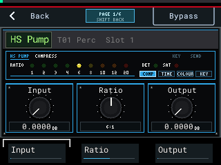

**COMPRESS**
| Knob | Control | Range | What it does |
|---|---|---|---|
| K1 | Input | 0 to 30 dB | Drive into the compressor. More input means more compression. |
| K2 | Ratio | 1:1, 2:1, 3:1, 4:1, 6:1, 8:1, 10:1, 12:1, 20:1 | At 1:1 there is no compression. The lamps show the ratio. |
| K3 | Output | -20 to +20 dB | Level out. |

**TIMING**
| Knob | Control | Range | What it does |
|---|---|---|---|
| K1 | Attack | 0.2, 1, 3, 6, 10, 20, 30, 40 ms | How fast it grabs. |
| K2 | Release | 50 ms, 0.1, 0.15, 0.2, 0.25, 0.3, 0.5 s, OPTO | OPTO lets go with a slow, smooth tail. |
| K3 | Attack Mod | OFF, up to 10 | Slows the very start of the attack. High settings also limit how far it compresses. |

**COLOUR**
| Knob | Control | Range | What it does |
|---|---|---|---|
| K1 | Saturation | OFF / ON | Adds saturation after the compressor. The SAT lamp shows it. |
| K2 | Detector HP | OFF / ON | Stops the lows from driving the compressor. The DET lamp shows it. |
| K3 | Mix | 0 to 100 % | Blend of compressed and dry. |

**KEY**
| Knob | Control | Range | What it does |
|---|---|---|---|
| K1 | Key In | OWN, BUS A to BUS D | OWN: it reacts to its own track. A bus: it reacts to the track that sends to that bus. |
| K2 | Send | OFF, BUS A to BUS D | Sends this track's level to a bus, for ducking or MOD. |

The KEY and SEND lamps at the top show the routing on every page. More in [MOD and the key bus](#mod-and-the-key-bus).

**Starting points**
- **Smashed drums:** Input 10 to 15 dB, Ratio 6:1 or 8:1, Attack 10 ms, Release 0.1 s, Saturation ON, Mix 40 to 60 %.
- **Vocal:** Ratio 3:1 or 4:1, Attack 3 ms, Release OPTO, Detector HP ON, then Input until the loud words are held.

**Bypass:** **B3**. A bypassed HS Pump does not send to a bus.

If it doesn't work: at Ratio 1:1 nothing is compressed, and nothing ducks from Key In either.

---

## HS Heat

**Category:** Harmonic. **Pages:** eight. **CHARACTER**, **FILTER**, **DIRT + EQ**, **ENVELOPE**, **LFO**, **OUTPUT**, then **MOD** and **MOD TIME**. The tabs read CHR, FLT, DRT, ENV, LFO, OUT.

Eight drive circuits into a multimode filter, with dirt, a 2-band EQ, an envelope follower and an LFO. The envelope and the LFO both move the filter frequency.

| CHARACTER page | FILTER page |
|---|---|
| 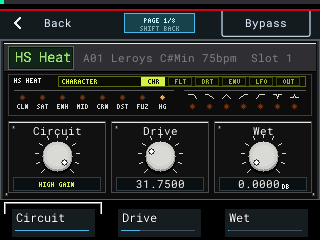 | 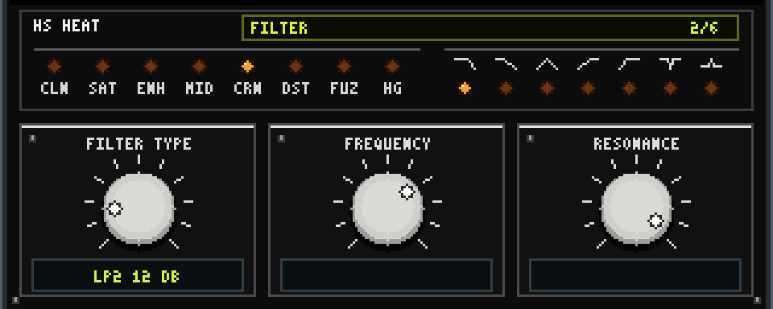 |

Both pictures are rendered at 3x from the panel drawing code, not emulator captures.

**CHARACTER**
| Knob | Control | Range | What it does |
|---|---|---|---|
| K1 | Circuit | CLEAN BOOST, SATURATION, ENHANCEMENT, MID DRIVE, ROUGH CRUNCH, CLASSIC DIST, ROUND FUZZ, HIGH GAIN | The type of drive. Gentle at the start of the list, heavy at the end. |
| K2 | Drive | 0 to 127 | How hard it drives. |
| K3 | Wet | -24 to +6 dB | Level of the driven sound. |

**FILTER**
| Knob | Control | Range | What it does |
|---|---|---|---|
| K1 | Filter Type | OFF, LP2 12 DB, LP1 6 DB, BAND PASS, HP1 6 DB, HP2 12 DB, NOTCH, PEAK | The filter after the drive. |
| K2 | Frequency | 0 to 127 | Filter frequency. |
| K3 | Resonance | 0 to 127 | Emphasis at the frequency. High settings can ring on their own. |

**DIRT + EQ**
| Knob | Control | Range | What it does |
|---|---|---|---|
| K1 | Dirt | 0 to 127 | Overdrives the filter input. |
| K2 | EQ Low | -64 to +63 | Low shelf cut or boost. |
| K3 | EQ High | -64 to +63 | High shelf cut or boost. |

**ENVELOPE**
| Knob | Control | Range | What it does |
|---|---|---|---|
| K1 | Env Depth | -128 to +127 | How far the playing level moves the filter. Negative moves it down. |
| K2 | Attack | 0 to 127 | How fast it follows a hit. |
| K3 | Release | 0 to 127 | How fast it falls back. |

**LFO**
| Knob | Control | Range | What it does |
|---|---|---|---|
| K1 | LFO Depth | -128 to +127 | How far the LFO moves the filter. |
| K2 | Speed | 0 to 127 | LFO speed. |
| K3 | Wave | TRI, SINE, SQR, SAW, EXP, RAMP, RND | LFO shape. |

**OUTPUT**
| Knob | Control | Range | What it does |
|---|---|---|---|
| K1 | Freq Pan | -64 to +63 | Moves the left and right filter frequencies apart, for width. |
| K2 | Mix | 0 to 100 % | Blend of the effect and the dry sound. |
| K3 | Volume | -24 to +12 dB | Final level. |

**MOD** and **MOD TIME**: see [MOD and the key bus](#mod-and-the-key-bus).

**Starting points**
- **Bass grit:** Circuit SATURATION or MID DRIVE, Drive about 40, Filter Type OFF, Mix 50 to 100 %. Use Volume to match the level.
- **Moving drum filter:** Circuit CLEAN BOOST, Filter Type LP2 12 DB, Frequency about 60, Resonance about 40, LFO Depth +40, Wave SINE.

**Bypass:** **B3**.

If it doesn't work: if the sound vanishes, check Filter Type and Frequency (a low-pass set very low cuts almost everything), then Wet and Volume.

---

## HS Para EQ

**Category:** EQ / Filter. **Pages:** two on GLOBAL, four on each band.

A 24-band parametric EQ with a response curve on the screen. Turn **DATA** to pick what you are editing: **GLOBAL** first, then bands **1** to **24**. The strip under the curve shows the band you are on.

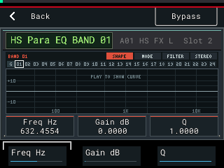

**GLOBAL** (turn **DATA** all the way left)
| Page | K1 | K2 | K3 |
|---|---|---|---|
| LEVELS | Input, -36 to +12 dB | Output, -36 to +12 dB | Mid/Side, OFF / ON |
| ROUTING | Parallel, OFF / ON | | |

- **Mid/Side ON:** a band set to LEFT/MID works on the middle of the stereo image, and a band set to RIGHT/SIDE works on the sides.
- **Parallel ON:** bell bands are added in parallel. Pass filters and shelves stay in series.

**Each band** (turn **DATA** to a band number)
| Page | K1 | K2 | K3 |
|---|---|---|---|
| SHAPE | Frequency, 20 to 20,000 Hz | Gain, -20 to +20 dB | Q, 0.3 to 10.3 |
| MODE | Type: HIGH PASS, LOW PASS, LOW SHELF, HIGH SHELF, BELL | Band On, OFF / ON | Band Bypass, OFF / ON |
| FILTER | Filter Family: CUSTOM Q, CRITICAL, BESSEL, GAUSSIAN, BUTTERWORTH, CHEBYSHEV | Slope: OFF, 6 to 48 DB/OCT | Bell Shape: nine shapes |
| STEREO | Position: LEFT/MID, RIGHT/SIDE, STEREO | | |

Filter Family and Slope shape the HIGH PASS and LOW PASS types. Bell Shape picks how the width of a BELL band behaves as you boost or cut.

**Starting points**
- **Clean up a kick or bass:** band 1, MODE: Type HIGH PASS, Band On. FILTER: Slope 12 DB/OCT. SHAPE: Frequency 30 to 40 Hz.
- **Take the boxiness out of a vocal:** band 2, MODE: Type BELL, Band On. SHAPE: Frequency 300 to 400 Hz, Gain -3 dB, Q 1.5.

**Bypass:** **B3** bypasses the whole EQ. Band Bypass on the MODE page bypasses just one band.

If it doesn't work: every band starts with Band On set to OFF. Turn it on. A HIGH PASS or LOW PASS band also needs a Slope above OFF before it does anything.

---

## HS Crush

**Category:** Dynamics. **Pages:** six. **COMPRESS**, **TIMING**, **AUDIO**, **KEY**, then **MOD** and **MOD TIME**.

A character compressor with eight curves, an Opto mode, detector filters, two distortion modes, a British-style mode and a gain-reduction meter (**GR DB**) on the panel. Input, Output, Attack and Release use a 0 to 10 scale.

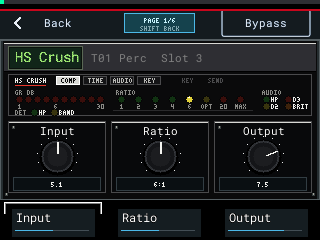

**COMPRESS**
| Knob | Control | Range | What it does |
|---|---|---|---|
| K1 | Input | 0 to 10 | Drive into the compressor. More input means more compression. |
| K2 | Ratio | 1:1, 2:1, 3:1, 4:1, 6:1, 10:1 OPTO, 20:1, MAX | 1:1 only adds the circuit's colour. 10:1 OPTO is a smooth opto mode. 20:1 and MAX limit hard. |
| K3 | Output | 0 to 10 | Level out. |

**TIMING**
| Knob | Control | Range | What it does |
|---|---|---|---|
| K1 | Attack | 0 to 10 (50 microseconds to 30 ms) | The screen shows the time next to the number. |
| K2 | Release | 0 to 10 (0.05 to 3.5 s, up to 20 s in 10:1 OPTO) | The screen shows the time next to the number. |
| K3 | Detector | NORM, HP, BAND, HP + BAND | HP stops the lows from driving it. BAND makes it react more to the area around 6 kHz. |

**AUDIO**
| Knob | Control | Range | What it does |
|---|---|---|---|
| K1 | Audio | CLEAN, HP, DIST 2, DIST 3, HP + DIST 2, HP + DIST 3 | HP cuts the lows of the sound itself. DIST 2 adds warm harmonics. DIST 3 adds more, with a tape-like flattening. |
| K2 | British | OFF / ON | A British-style compression mode. The BRIT lamp shows it. |
| K3 | Mix | 0 to 100 % | Blend of compressed and dry. |

**KEY**: the same as HS Pump. **K1** Key In (OWN or BUS A to D), **K2** Send (OFF or BUS A to D). See [MOD and the key bus](#mod-and-the-key-bus).

**Starting points**
- **Vocal:** Ratio 4:1, Attack 3, Release 5, Detector HP, then Input until GR DB shows a few dB on the loud words.
- **Drum room smash:** Ratio 20:1 or MAX, Attack 2, Release 3, Audio DIST 2, Mix 30 to 50 %.

**Bypass:** **B3**. A bypassed HS Crush does not send to a bus.

If it doesn't work: if GR DB shows **NO METER**, the meter could not be read, but the effect still works. At Ratio 1:1 nothing is compressed.

---

## HS Bass Focus

**Category:** EQ / Filter. **Pages:** one.

Splits the sound at a crossover, makes the lows mono and sets their level. The highs pass untouched. The panel draws the response it applies, with a dotted line at the crossover.

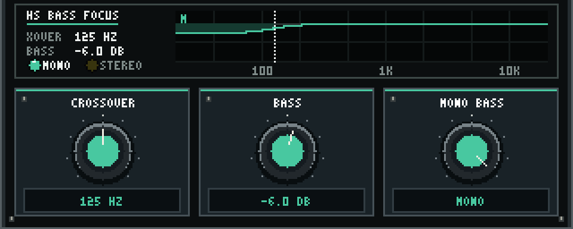

| Knob | Control | Range | What it does |
|---|---|---|---|
| K1 | Crossover | 30 to 500 Hz | Where lows end and highs begin. |
| K2 | Bass | -24 to +8 dB | Level of the lows only. |
| K3 | Mono Bass | MONO / STEREO | MONO puts everything below the crossover in the middle. |

**Starting points**
- **Bass or 808:** Crossover 100 to 150 Hz, Bass 0 dB, MONO.
- **Wide sample with a messy low end:** Crossover about 120 Hz, Bass -3 to -6 dB, MONO.

**Bypass:** **B3**.

If it doesn't work: with Bass at 0 dB on a sound with no stereo lows, you will hear little change. That is expected. Try a wide stereo sample.

---

## HS Tube Strip

**Category:** Harmonic. **Pages:** nine. **TUBE**, **OPTO COMP**, **COMP TIME**, **BASS**, **LOW MID**, **HIGH MID**, **TREBLE**, then **MOD** and **MOD TIME**.

A tube channel strip: tube drive, a 6 dB/oct high-pass, an opto compressor and a 4-band EQ. The panel shows the gain reduction (**OPTO GR DB**) and the signal path in order. The EQ can go before or after the compressor, and a side-chain EQ turns it into a de-esser.

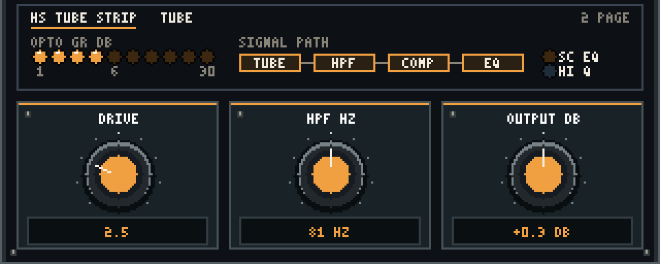

**TUBE**
| Knob | Control | Range | What it does |
|---|---|---|---|
| K1 | Drive | 0 to 10 | Tube drive. |
| K2 | High-Pass | OFF, 30 to 140 Hz | 6 dB/oct cut of the lows. |
| K3 | Output | -20 to +20 dB | Level out. |

**OPTO COMP**
| Knob | Control | Range | What it does |
|---|---|---|---|
| K1 | Threshold | -30 to +20 dB | Lower means more compression. |
| K2 | Ratio | 1:1 to 20:1 | How hard it compresses. |
| K3 | Attack | 2 to 200 ms | How fast it grabs. |

**COMP TIME**
| Knob | Control | Range | What it does |
|---|---|---|---|
| K1 | Release | 100 ms to 5 s | How fast it lets go. |
| K2 | EQ First | COMP > EQ / EQ > COMP | Order of the compressor and the EQ. The SIGNAL PATH on the panel follows it. |
| K3 | Sidechain EQ | OFF / ON | ON: the two mid bands stop changing the sound and change what the compressor listens to instead. Use it for de-essing. |

**BASS**
| Knob | Control | Range |
|---|---|---|
| K1 | Frequency | 15, 30, 60 or 150 Hz |
| K2 | Gain | -24 to +24 dB |

**LOW MID**
| Knob | Control | Range |
|---|---|---|
| K1 | Frequency | 30 to 4,500 Hz |
| K2 | Gain | -16 to +16 dB |
| K3 | High Q | LOW / HIGH (width of both mid bands) |

**HIGH MID**
| Knob | Control | Range |
|---|---|---|
| K1 | Frequency | 200 to 20,000 Hz |
| K2 | Gain | -16 to +16 dB |
| K3 | High Q | LOW / HIGH (the same switch as on LOW MID) |

**TREBLE**
| Knob | Control | Range |
|---|---|---|
| K1 | Frequency | 10, 15, 20 or 32 kHz |
| K2 | Gain | -20 to +20 dB |

**MOD** and **MOD TIME**: see [MOD and the key bus](#mod-and-the-key-bus).

**Starting points**
- **Vocal:** Drive 3, High-Pass 80 Hz, Ratio 3:1, Attack about 10 ms, Release about 300 ms, then lower Threshold until OPTO GR DB moves a few dB on the loud words. TREBLE Gain +2 dB at 15 kHz for air.
- **De-esser:** Sidechain EQ ON. HIGH MID Frequency 6 to 7 kHz, Gain +10 dB, High Q HIGH. Lower Threshold until the "s" sounds are held down.

**Bypass:** **B3**.

If it doesn't work: Threshold starts at +20 dB, where the compressor is idle. Turn it down. With Sidechain EQ ON, the mid bands no longer change the tone.

---

## HS Air Exciter and HS Drive Sat

These two are no longer in the effect list, to make room for the nine above. They are still installed, so projects that use them open as before, and the VOX and BASS [track chains](#track-chains) load them. You edit them like any other HS effect.

- **HS Air Exciter:** Frequency (2,000 to 12,000 Hz), Drive (0 to 18 dB) and Amount (0 to 1). It does nothing until Amount is above 0.
- **HS Drive Sat:** pages **DRIVE** (Drive, Shape, Depth), **HARMONICS** (Harmonics, Mix, +6dB Headroom), **I/O** (Input, Output), then **MOD** and **MOD TIME**.

If it doesn't work: you can't add them from the list. Load them with a chain, or open a project that already has them.

---

## MOD and the key bus

Two features let one track control another, using four shared buses: **A**, **B**, **C** and **D**.

**The key bus (ducking).** HS Pump and HS Crush have a **KEY** page.

1. On the track that should do the pushing (for example the kick), add HS Pump or HS Crush. On its **KEY** page, set **K2** Send to **BUS A**. To only send, and not change that track's sound, set its Ratio to 1:1.
2. On the track that should duck (for example the bass), add HS Pump or HS Crush. On its **KEY** page, set **K1** Key In to **BUS A**.
3. Set a Ratio above 1:1 on the ducking track. It now turns down each time the kick plays.

**MOD (envelope follower).** Seven HS effects have a **MOD** page and a **MOD TIME** page, the last two pages: HS Pump, HS Crush, HS Tube Strip, HS Heat, HS Channel Strip, HS Drive Sat and HS Bus Compressor. MOD makes one knob move with the level on a bus.

**MOD**
| Knob | Control | Range | What it does |
|---|---|---|---|
| K1 | Source | OFF, BUS A to BUS D | Which bus to follow. OFF switches MOD off. |
| K2 | Target | any control of this effect | Which control moves. The panel shows its page and name, like "FILTER / Frequency". |
| K3 | Depth | -100 to +100 % | How far it moves, as a share of that control's range. Negative moves it the other way. |

**MOD TIME**
| Knob | Control | Range | What it does |
|---|---|---|---|
| K1 | Attack | 1 to 1,000 ms | How fast it follows a rise. |
| K2 | Release | 10 to 5,000 ms | How fast it falls back. |

The Target knob keeps showing the value you set. The effect hears that value plus the movement.

**Example:** kick on one track with HS Pump, KEY Send **BUS A**, Ratio 1:1. On a pad or loop track, HS Heat with Filter Type LP2 12 DB. On its MOD page: Source **BUS A**, Target **Frequency**, Depth +40 %. The filter opens on every kick.

MOD is off by default (Source OFF), so old projects sound the same.

If it doesn't work: a bus only carries a level while the sending track plays and its HS Pump or HS Crush is not bypassed. The MOD panel says **SEND THE BUS FROM HS PUMP OR CRUSH KEY PAGE** as a reminder.

---

## Track chains

A chain is a set of insert effects that loads when you give a track a matching name.

**Load a chain**
1. Press **PAD FX**, then **B1** until you are on the **Track** insert page.
2. Press **SHIFT** + **B1** to open the name editor.
3. Turn **DATA** to change the letter at the cursor, press **+** to move to the next letter, **B2** (Erase) to delete. Press **B3** (Do It!) when done.
4. If the track has no inserts yet and the name starts with a chain name, the chain loads.

The shipped chains:

| Track name starts with | Chain loads |
|---|---|
| VOX, VOCAL or VOCALS | HS Channel Strip, HS Bus Compressor, HS Air Exciter |
| DRUMS, DRUM or DRM | HS Saturator, HS Bus Compressor |
| BASS | HS Drive Sat, HS Para EQ |
| KICK | HS Tube Strip, set for a kick |
| BASSLINE | HS Tube Strip, set for a bassline |

Case doesn't matter. The name has to start with the whole word: "Bass 2", "Bass-1" and "Bass2" match BASS, "Bassline 2" matches BASSLINE, "Kickdrum" matches nothing. The VOX, DRUMS and BASS effects load at their starting settings, so dial them in to taste.

KICK and BASSLINE open the strip already set up, no preset slot needed. The slot shows its short name, hs_tube_strip.

- **KICK:** Drive 3.5, High-Pass OFF, Threshold -8 dB, Ratio 4:1, Attack 15 ms so the click gets through, Release 110 ms. Bass +2 dB at 60 Hz, Low Mid -3 dB at 350 Hz to take out the cardboard, High Mid +2 dB at 4 kHz for the beater. Output +1.5 dB.
- **BASSLINE:** Drive 3, High-Pass 30 Hz, Threshold -10 dB, Ratio 3:1, Attack 30 ms, Release 300 ms. Bass +3 dB at 60 Hz, Low Mid -2 dB at 250 Hz, High Mid +2 dB at 900 Hz so it reads on small speakers, Treble -2 dB. Output +1 dB.

Values can show a hair off (110 ms as 111 ms): the MPC stores each knob to about 1 %.

The name presets in the rename list work too: **Bass**, **Drums** and **Vocal** load their chains.

**One UNDO** (**SHIFT** + **MINUS**) takes back the rename and the chain together.

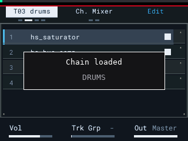

**Save your own chain**
1. Set up the inserts on a track the way you like them.
2. Rename the track with a **#** on the end, like **KEYS#**. Use letters, digits, - or spaces.
3. The chain is saved to `MPC-Sample/Chains/KEYS.xfx` on the card, with every effect's settings. The track is named **KEYS** again.
4. From now on, any empty track you name KEYS gets that chain. A chain you save wins over a shipped one with the same name, so **VOX#** replaces the VOX chain for you.

**The box on the screen** says what happened:

| Box | Second line | Meaning |
|---|---|---|
| Chain loaded | the chain name | It worked. |
| Chain saved | NAME: 3 effects | It worked. |
| Chain not loaded | Track already has effects | Chains only load on a track with no inserts. Clear them or use another track. |
| Chain not loaded | NAME.xfx is damaged | The file is incomplete. Save it again. |
| Chain not saved | No effects on the track | There was nothing to save. |
| Chain not saved | Use letters, digits, - or space | The name has a character it can't use. |
| Chain not saved | NAME: could not write | The card could not be written. Check it isn't full or locked. |

If it doesn't work: chains only load on a track with no inserts, and the name must start with the whole chain word. Read the box: it says why.

---

## Key and BPM in the browser

When you preview a sample in the browser, its row shows the key and tempo at the right end, like **C# MIN 75 BPM**. The key is white, the tempo grey. Works with WAV and MP3.

- The tempo is the one the preview plays at.
- The key takes a moment to appear while the MPC works it out.
- Besides MAJ and MIN, you may see modes such as DORIAN or MIXO. A one-shot shows a single note, like **NOTE E**.
- Scroll away and the tag hides. Come back to the row and it shows again.

There is nothing to press. It is just there while you browse.

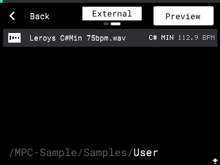

If it doesn't work: the tag only shows for a sample that is previewing. Check Preview is on in the browser.

---

## SEQ desk and the METERS page

Press **SEQ**. The SEQ page is redrawn as a mixing desk: a VU meter and output LEDs that move with what the MPC plays, the tempo, Rec Quant, the transport and the three bottom controls. **K1** still sets the BPM, and every stock control works as before.

Press **B2** to switch to the **METERS** page:

- Left and right VU meters.
- **LUFS M** (momentary), **LUFS S** (short-term) and **LUFS I** (integrated) loudness.
- **PEAK**: the highest peak. It turns red above -1 dB.
- LUFS I and PEAK start again after 2 seconds of silence.

Press **B2** again to go back to the desk. The SEQ page always opens on the desk.

| SEQ desk | METERS page |
|---|---|
| 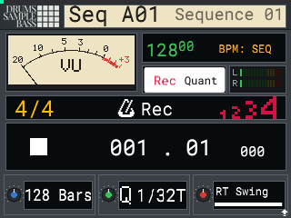 | 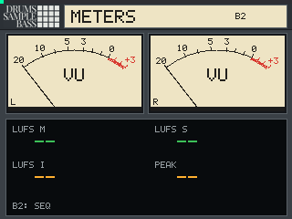 |

If it doesn't work: the meters only move while the MPC is playing sound. The readouts show dashes when there is nothing to measure.

---

## Stems

Stems splits a sample into **Vocals**, **Drums**, **Bass** and **Other** on the MPC itself, no computer needed. It is optional: it is only there if you ticked **Add Stems** in the installer.

**From the browser**
1. Highlight a WAV or MP3 so it previews.
2. Hold **SHIFT**, then hold **B1** for 1.5 seconds. **B1** shows **Stems...** while you hold. A quick press keeps its normal job.
3. The chooser opens.

**From a pad**
1. Open the **Sample** screen with the pad selected.
2. Hold **SHIFT**, then hold **B3** for 1.5 seconds.
3. The chooser opens for that pad.

**In the chooser**
- Turn **DATA** (or press **-** and **+**) to move. Push **DATA** to tick or untick a stem.
- **B2** switches between **Separate** (one file per ticked stem) and **Sum** (the ticked stems mixed into one file).
- **B3** (**Go**) starts. **B1** (**Cancel**) closes the chooser.
- While it runs, **B1** (**Cancel**) stops it and removes the files from this run.

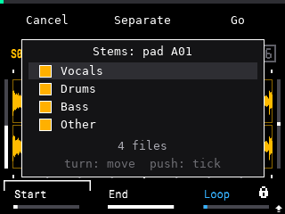

A split takes about as long as the sample plays. Nothing above 11 kHz comes through in any stem.

**Where the files go**
- From the browser: a folder named after the sample plus "Stems", next to the original file.
- From a pad: `MPC-Sample/Samples/Stems` on the card.

**Onto pads (pad splits only).** The stems also load onto the next empty pads of that pad's bank, on the same track. Your original pad is never changed. The box says where, for example **On pads A02-A05**. If the bank fills up, the box says **bank full**, and the files stay in `MPC-Sample/Samples/Stems`.

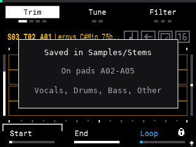

**UNDO** (**SHIFT** + **MINUS**) takes the last loaded stem off its pad, one stem per press.

Good to know:
- A pad split uses the whole sample file. Trim, tune and other pad settings are not applied. A pad with layers uses its first layer.
- Just after you load or edit a pad, the box may say **Waiting for the autosave...** for a few seconds. That is normal.

If it doesn't work: if holding **SHIFT** + **B1** does nothing in the browser, make sure the sample is previewing. If the box shows an error, it stays until you press a button; read it, then try again.

---

## SampQOL screens in HS colours

SampQOL's own list screens, such as the insert pages and the effect list, get a red bar along the top, a dark blue palette and a cyan edge on the selected row, to match the rest of the kit. There is nothing to set. It works the same way, it only looks different.

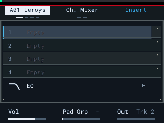

If it doesn't work: if the screens look like plain SampQOL, you are probably not on SampQOL 0.2.0. The styling only applies to that version.

---

## Graphic mixer

Press **PAD FX**, then **B2**. SampQOL's **Ch. Mixer** is drawn as a console. Press **B2** again for the **Pad Mixer**.

- Eight strips per page. Each has a pan knob, **M** (mute) and **S** (solo), a fader, a stereo meter with peak hold, and the output name at the bottom.
- The selected strip has a **cyan** frame. It turns **yellow** while you edit it.
- The knobs and buttons do what they do in SampQOL's mixer. See SampQOL's manual for the controls.

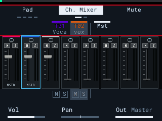

If it doesn't work: like the screen styling, the graphic mixer only draws on SampQOL 0.2.0. On any other version you get SampQOL's own mixer.

---

## Project snapshots

Automatic project backups are a SampQOL feature, not part of this kit. See [SampQOL's manual](https://github.com/snarebes/SampQOL-OS) for how they work.

---

Something not working as this guide says? [Report it](https://github.com/hmukhwana/henryskillz-mpc-sample-mod-kit/issues) with your firmware version, what you pressed and what you saw.
